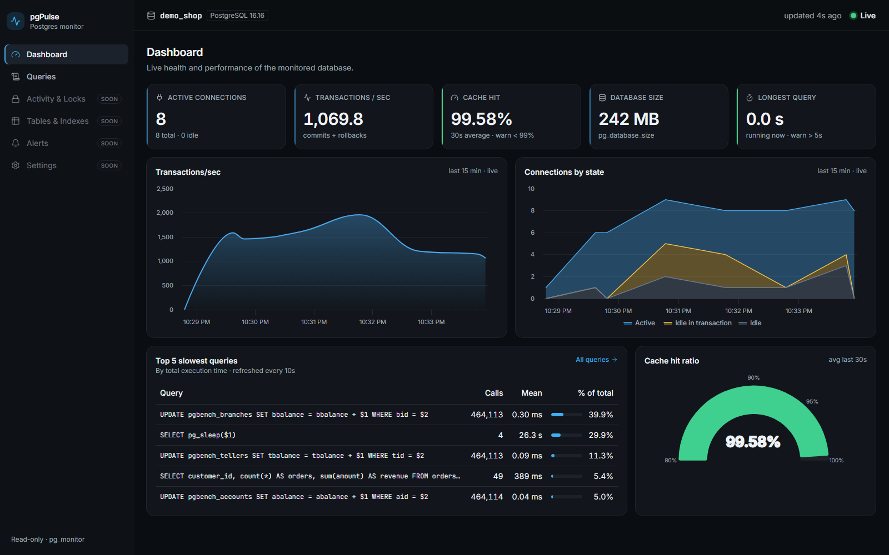
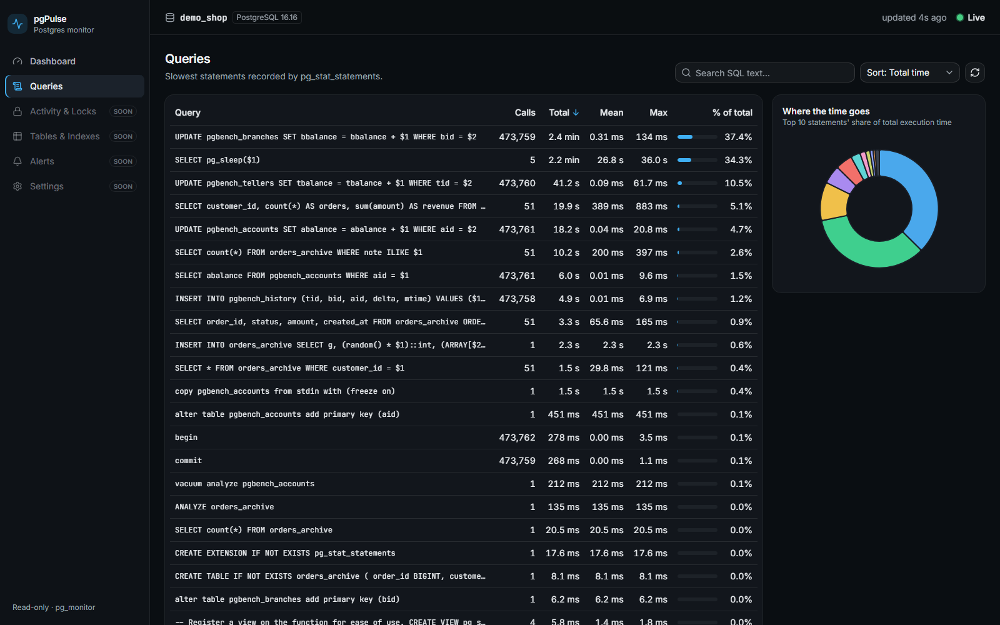
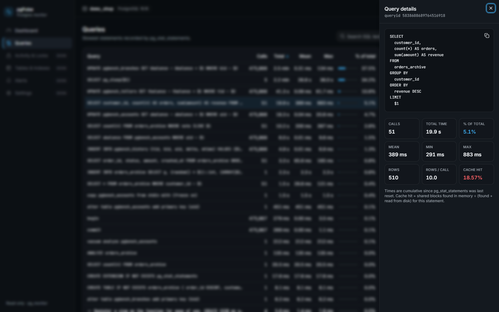
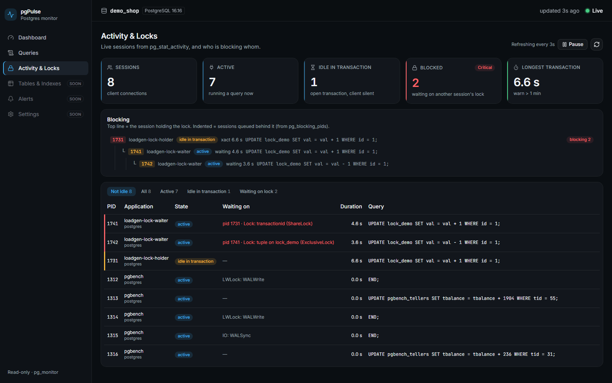

# pgPulse

**Live PostgreSQL health and performance dashboard.** Connections, transactions per second, cache hit ratio, database size, the longest running query and the slowest statements, updating in real time.



## What it is and why

When an app slows down, the cause is very often the database: one expensive query, a missing index, a transaction left open. Postgres already records all of this in its built-in statistics views (`pg_stat_activity`, `pg_stat_database`, `pg_stat_statements`), but reading them means knowing the right SQL and doing arithmetic on raw counters. pgPulse connects with a **read-only** monitoring role, reads those views, and turns them into a live dashboard and a searchable slow-query explorer.

## Features

- **Live dashboard over WebSockets.** Five KPI cards (active connections, TPS, cache hit %, database size, longest running query) that update every 2 seconds and turn amber or red at thresholds.
- **Live Highcharts.** A transactions/sec line and a "connections by state" stacked area covering the last 15 minutes. They are pre-filled from stored history, then new points are appended with `series.addPoint` instead of re-rendering the chart.
- **Slow queries page.** Search (debounced), sort by total time, mean time or calls, % share of total execution time, a donut of the top 10, and a detail drawer with formatted SQL, a copy button and per-query cache hit ratio.
- **Activity & Locks.** Every session from `pg_stat_activity` (state, wait event, how long its transaction has been open) and a **blocking tree** built from `pg_blocking_pids()`. It shows which session holds the lock, who is queued behind it, and the exact lock each one waits for (from `pg_locks`). The page polls every 3 seconds, pauses while the tab is hidden, and can be paused to read a snapshot.
- **Shareable state.** Sort, search and the open query live in the URL (`/queries?sort=mean_time&q=orders&queryId=…`). The dashboard's top-5 rows link straight to a query's drawer.
- **Metric history.** A sample is saved to pgPulse's own database every 60 seconds and kept for 7 days.
- **Safe by design.** It never writes to the monitored database: a dedicated `pg_monitor` role, read-only sessions, a 5-second statement timeout and a pool of at most 5 connections.
- **Resilient.** If the server or the database goes away, the UI shows a clear banner, keeps the last data and reconnects automatically.
- **Accessible.** The sidebar and table rows are keyboard-navigable, focus rings are visible, icon buttons have labels, status is never shown by colour alone, and `prefers-reduced-motion` is respected.
- **One-command demo.** `docker compose up` starts Postgres with generated traffic and deliberately slow queries, plus the API and the UI.

<table>
  <tr>
    <td></td>
    <td></td>
  </tr>
</table>



*Activity & Locks catching the classic incident: a client opened a transaction, updated a row and went quiet ("idle in transaction"), so two other writers queue behind its row lock.*

## Quick start (Docker)

Requires [Docker Desktop](https://www.docker.com/products/docker-desktop/) (or Docker Engine with Compose v2).

```bash
git clone https://github.com/Omkar-Gadagi/pgpulse.git
cd pgpulse
cp .env.example .env          # Windows PowerShell: Copy-Item .env.example .env
docker compose up --build
```

Open **http://localhost:5173**. The dashboard goes live within a few seconds.

| Service | What it is | Host port |
|---|---|---|
| `postgres` | PostgreSQL 16 with `pg_stat_statements`: `demo_shop` (monitored) and `pgpulse` (app) | `5433` |
| `loadgen` | `pgbench` traffic, slow queries on a 500k-row table with no index, and a staged lock conflict every 30–60 s | n/a |
| `server` | pgPulse API (Express + Socket.IO) | `4000` |
| `web` | pgPulse UI (static build served by nginx) | `5173` |

Ports are configurable in `.env` (`POSTGRES_PORT`, `SERVER_PORT`, `WEB_PORT`). Stop with `docker compose down`; add `-v` to also delete the demo data.

## Local development

Run the database in Docker and the app on your machine, with hot reload:

```bash
npm install
docker compose up -d postgres loadgen   # Postgres on localhost:5433
npm run dev:server                      # API on http://localhost:4000 (node --watch)
npm run dev:web                         # UI on http://localhost:5173 (Vite)
```

`npm run watch:metrics` prints the live Socket.IO feed in the terminal, which is handy for checking the server without the UI.

> Docker's `server`/`web` containers and the local dev servers use the same ports (4000, 5173). Run one or the other.

## Architecture

```
 Browser ─ React + TypeScript (Vite, React Router, Tailwind, shadcn/ui, Highcharts)
   │  REST       /api/*            health, overview, slow queries, history
   │  Socket.IO  "dashboard" room  metrics:update every 2s, queries:top every 10s
   ▼
 Node.js server ─ Express + Socket.IO
   ├─ overview collector ── runs only while someone is subscribed to the dashboard
   ├─ history sampler ───── every 60s, independent of viewers (no gaps in history)
   │
   ├─ targetPool (max 5, read-only, statement_timeout 5s)
   │     └──► monitored Postgres  "demo_shop"   pg_stat_activity, pg_stat_database,
   │                                            pg_stat_statements
   └─ appPool
         └──► pgPulse's own Postgres "pgpulse"  metric_samples (7-day retention)
```

**Two databases, on purpose.** The monitored database (`demo_shop`) is only ever read. pgPulse's own history goes into a separate database (`pgpulse`), so the tool never adds tables or writes load to the system it watches. In the demo both live in one Postgres container; in real use the target would be any Postgres you point `TARGET_DATABASE_URL` at.

**Read-only, three ways.** The server connects to the target as `pgpulse_reader`:
1. The role is granted the built-in **`pg_monitor`** role, which can read every statistics view (including other users' query text) but no table data.
2. Every session runs with `default_transaction_read_only = on`, set on the role *and* by the pool.
3. Every statement is cancelled after 5 seconds, and the pool holds at most 5 connections.

**Socket.IO for live data, REST for everything else.** The dashboard needs a push every 2 seconds, so it joins a Socket.IO room. The server starts its collector when the first client joins and stops it when the last one leaves, so an idle pgPulse puts no load on the database. Everything that's requested on demand (slow queries, history, health) is plain REST. Clients re-join the room after every reconnect, because the server forgets room membership when a socket drops.

## How the metrics are calculated

`pg_stat_database` exposes **cumulative counters** since the last stats reset. On their own they only ever grow, so pgPulse takes two readings and uses the difference (the delta):

```
TPS             = Δ(xact_commit + xact_rollback) / Δseconds
cache hit ratio = Δblks_hit / (Δblks_hit + Δblks_read)
```

Edge cases handled in [`collectors/overview.js`](apps/server/src/collectors/overview.js):
- **No baseline, or one older than 30s:** take a reading, wait 1s, then measure.
- **Negative deltas:** the stats were reset (`pg_stat_reset`), so report `null` instead of nonsense.
- **Windows shorter than 250 ms:** ignored as too noisy.
- **Concurrent readers share one read:** a REST call and a timer tick at the same moment cause one database read, not two.

The other numbers are read directly:
- **Connections:** `pg_stat_activity` grouped by state (excluding the backend running this very query).
- **Database size:** `pg_database_size()`.
- **Longest query:** `now() - query_start` of the oldest active statement.
- **Slow queries:** `pg_stat_statements`, merged by `queryid`, excluding pgPulse's own monitoring queries. The % share is computed against *all* statements, so it stays honest while searching.

The cache-hit KPI shows a **30-second average**, because a single 2-second window swings too much to read (big sequential scans bypass most of the buffer cache).

| Threshold | Amber | Red |
|---|---|---|
| Cache hit ratio | < 99% | < 95% |
| Longest running query | > 5 s | > 30 s |

## API reference

### REST

| Method | Endpoint | Returns |
|---|---|---|
| `GET` | `/api/health` | `{ ok, targetReachable, postgresVersion, database, error? }`. Always 200 while the API is up. |
| `GET` | `/api/overview` | The current snapshot (same shape as `metrics:update`). |
| `GET` | `/api/queries?sort=total_time&limit=50&search=` | `{ sort, limit, search, totalExecTimeMs, queries[] }`. `sort` ∈ `total_time`, `mean_time`, `calls` (whitelisted); `limit` 1–200. |
| `GET` | `/api/queries/:queryId` | One statement: SQL, calls, total/mean/min/max time, rows, block hits/reads, cache hit ratio, % of total. 404 if unknown. |
| `GET` | `/api/metrics/history?range=1h` | `{ range, samples[] }`, oldest first; `range` ∈ `1h`, `6h`, `24h`. |
| `GET` | `/api/activity` | `{ ts, summary, sessions[] }`. Each session has state, wait event, transaction/query/state durations, `blockedBy[]`, `blocking[]` and `waitingFor { locktype, mode, relation }`. |

Invalid input gets a `400` with the allowed values, and an unreachable database gets a `503` with the reason. Search text and ids are bind parameters, and `ORDER BY` comes from a server-side whitelist, so there's no SQL injection path.

### Socket.IO

| Direction | Event | Payload |
|---|---|---|
| client → server | `dashboard:subscribe` / `dashboard:unsubscribe` | none |
| server → client | `metrics:update` (every 2 s) | `{ ts, connections: { active, idle, idleInTransaction, total }, tps, cacheHitRatio, dbSizeBytes, longestQuerySeconds }` |
| server → client | `queries:top` (every 10 s) | `{ ts, queries[] }`: top 5 by total time |
| server → client | `target:status` (on change) | `{ reachable, error? }` |

## Tech stack

| Layer | Tools |
|---|---|
| Frontend | React 19, TypeScript, Vite, React Router, Tailwind CSS v4, shadcn/ui (Radix), Motion, lucide icons |
| Charts | Highcharts + `highcharts-react-official` (shared dark theme) |
| Realtime | Socket.IO (server + client) |
| Backend | Node.js 20, Express 5 (plain JavaScript, ES modules), `pg` (node-postgres) |
| Database | PostgreSQL 16, `pg_stat_statements`, `pgbench` for demo load |
| Tooling | npm workspaces monorepo, Docker Compose, nginx |

## Project structure

```
pgpulse/
├── apps/
│   ├── server/                  Node.js API (JavaScript, ES modules)
│   │   ├── src/
│   │   │   ├── index.js         Express + Socket.IO bootstrap, graceful shutdown
│   │   │   ├── config.js        environment variables, validated
│   │   │   ├── socket.js        dashboard room, starts/stops the collectors
│   │   │   ├── db/              target (read-only) and app pools, startup migration
│   │   │   ├── collectors/      overview (deltas), queries, activity, 60s history sampler
│   │   │   ├── routes/          health, overview, queries, metrics, activity
│   │   │   └── sql/             the statistics queries, as real .sql files
│   │   ├── scripts/watch-metrics.js
│   │   └── Dockerfile
│   └── web/                     React + TypeScript UI
│       ├── src/
│       │   ├── app/             router, layout, live-status provider
│       │   ├── pages/           Dashboard, Queries, Activity
│       │   ├── components/      layout/, dashboard/, queries/, activity/, ui/ (shadcn)
│       │   ├── hooks/           useSocket, useMetrics, useQueries, useActivity, …
│       │   ├── charts/          Highcharts setup, dark theme, live-window helper
│       │   └── lib/             api client, types, formatters, thresholds
│       ├── nginx.conf
│       └── Dockerfile
├── docker/
│   ├── postgres/                init.sh + init.sql (databases, read-only role, schema)
│   └── loadgen/run.sh           pgbench, slow queries, long sleeps, a staged lock conflict
├── docs/screenshots/
├── docker-compose.yml
└── .env.example
```

## Roadmap

- [x] Live dashboard (KPIs, TPS, connections, top queries, cache gauge)
- [x] Slow queries page (search, sort, detail drawer, top-10 donut)
- [x] One-command Docker demo
- [x] **Activity & Locks**: live sessions and a blocking-lock tree
- [ ] **Tables & Indexes**: sizes, dead rows, vacuum status, unused indexes (treemap)
- [ ] History range picker (1h / 6h / 24h; the API already supports it)
- [ ] **Alerts**: threshold rules and alert history
- [ ] **Settings**: saved connections, connect to any database from the UI
- [ ] Frontend tests (Vitest + React Testing Library)
- [ ] GitHub Actions CI (lint, type-check, tests, Docker build)
- [ ] Hosted live demo

## License

[MIT](LICENSE) © 2026 Gadagi Omkar

Charts use [Highcharts](https://www.highcharts.com/), which is **free for non-commercial use; commercial use requires a Highcharts licence.**
